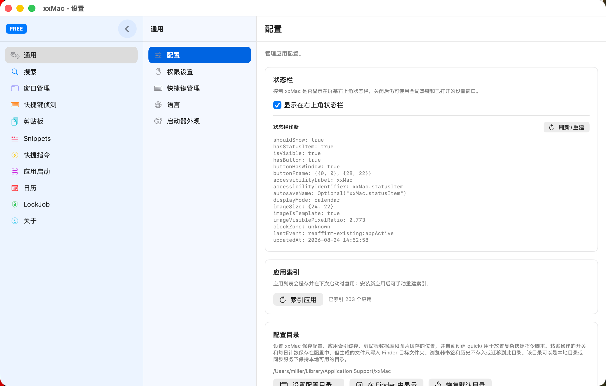
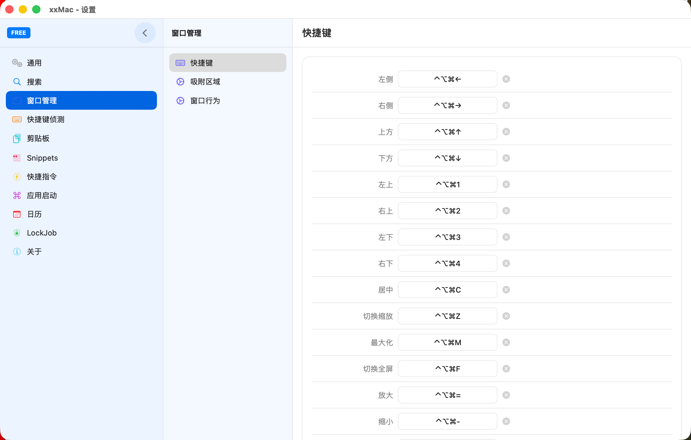
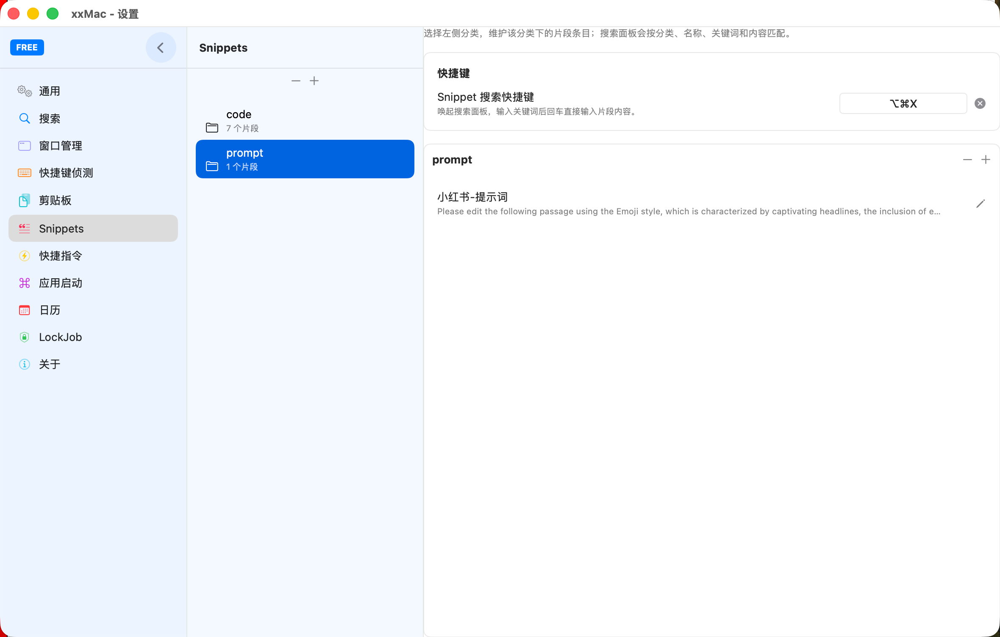
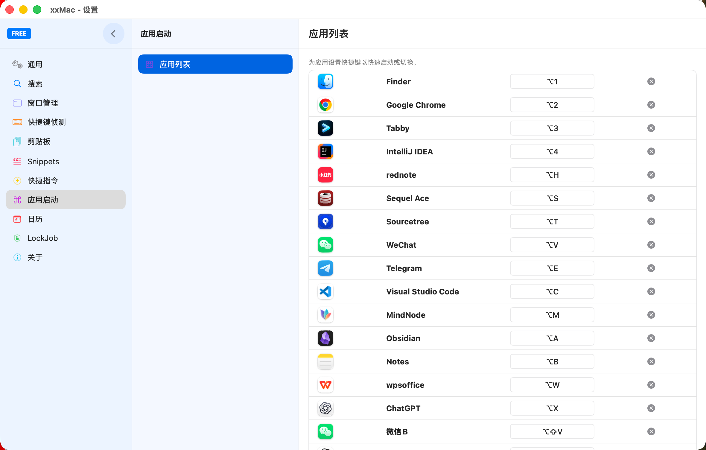
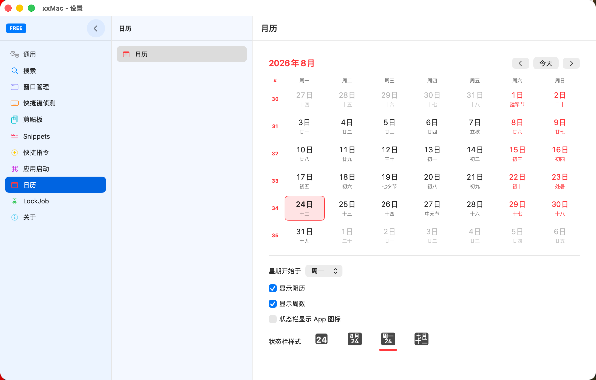
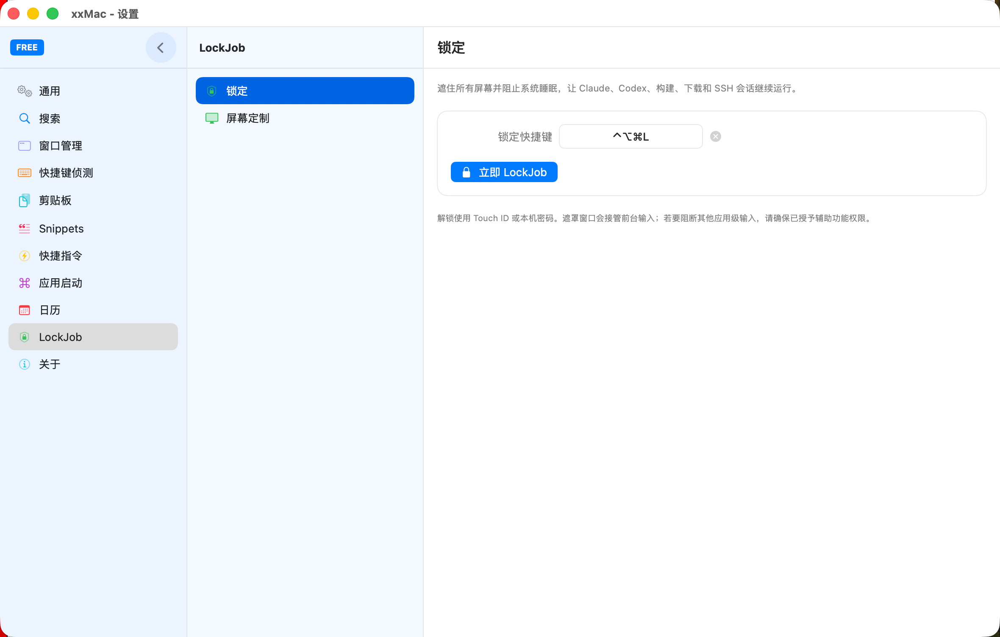
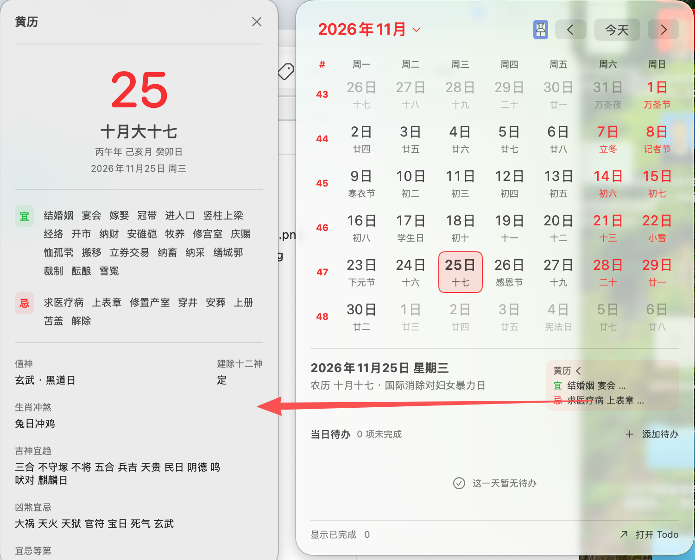

# xxMac

简体中文 | [English](README.md)

xxMac 是基于 SwiftUI + AppKit 构建的轻量级 macOS 原生效率工具。从菜单栏或全局快捷键出发，快速启动应用、整理窗口、检索剪贴板、管理待办，让日常操作更顺手。

菜单栏弹出菜单为启动器、剪贴板历史、待办、LockJob、输入法、设置和退出配备统一尺寸的彩色 SF Symbols 图标。

**macOS 13+** · 桌面小组件需 macOS 14+ · 简体中文 / 繁體中文 / English

[快速开始](#快速开始) · [默认快捷键](#默认快捷键) · [系统权限](#系统权限)

## 功能全景

<p align="center">
  
</p>

## 功能详情

<details>
<summary>展开完整功能说明</summary>

| 能力 | 说明 | 类似/替代 |
| --- | --- | --- |
| 启动器 | 通过全局热键打开半透明浮层，搜索应用、执行窗口命令、选择剪贴板历史；支持最近操作历史、键盘翻页选择、自定义底色、透明度、内容大小和窗口宽高。面板可拖动背景调整位置，并记住上次拖动后的位置。 | Alfred / Spotlight |
| 启动器计算器 | 在启动器搜索栏直接输入 `4+8`、`(2+3)*4`、`-3.5/2` 等四则运算表达式，实时显示计算结果，回车复制结果。 | Alfred Calculator / Spotlight |
| 应用快捷启动 | 为指定 App 绑定独立热键，支持启动、激活、隐藏切换。使用统一的全局热键注册，在 Carbon 事件未送达时通过已获辅助功能授权的事件监听兜底；录制快捷键时临时暂停，结束后自动恢复。 | Thor |
| 输入法（默认关闭） | 根据应用、网站或浏览器地址栏自动切换输入法；支持应用记忆、轻量提示、直达/循环快捷键和菜单栏快速设置。 | Input Source Pro |
| 窗口管理 | 快捷操作窗口左右半屏、上下半屏、四角、居中、最大化、缩放、跨屏移动等。方向操作始终切换到对应半屏（包括从四角窗口切换）；先调整尺寸再设置最终位置，避免缩放时窗口位置被修正。需要在“系统设置 > 隐私与安全性 > 辅助功能”中授权；重新打包或移动 App 后，需要删除旧 App 授权并重新添加当前 App。 | ShiftIt |
| Finder 粘贴操作 | 在 Finder 里复制文件或文件夹后，可在 Finder 以外的前台应用中按 `Command + Shift + V` 粘贴完整路径，适合终端、编辑器、聊天窗口等场景。在 Finder 内使用同一快捷键可将剪贴板原始图片或文本保存为文件；若剪贴板是文件则忽略，避免把长路径逐字输入 Finder。 | Copy Path / Path Finder |
| 中国日历 | 提供右上角状态栏入口，支持中国农历、节假日、节气、周数和状态栏图标样式配置。月历下方联动展示所选日期截止的 Todo，默认今天；无待办时紧凑显示，待办列表固定高度并独立滚动，支持快速添加、完成/撤销、延期到明天和打开 Todo，日期圆点提示未完成事项。支持方向键切换日期/周、⌘←/→ 切月，以及 📌/⌘P 固定当前弹窗。点击左上角年月，弹出年、月两列滚轮，确认后跳转（1900–2100 年）。简体和繁体中文界面在日期右侧显示黄历宜忌摘要（英文界面不显示黄历），点击在日历左侧展开详情卡，包含完整宜忌、干支、值神、建除、冲煞、吉神凶煞、等第及彭祖百忌；随所选日期联动，支持关闭和固定弹窗。黄历离线可用，无需安装 Python 或运行后台进程。农历日期由系统自动计算；节日规则、节气及除夕日期表随应用内置。放假和补班按政府年度公告单独配置在 `Resources/calendar_holidays.json`（`1` 为补班、`2` 为放假），未配置年份不会自行推算放假安排。 | CalendarX |
| 快捷键捕捉 | 记录快捷键被哪个 App 接收，用于定位快捷键冲突。 | Shortcut Detective |
| 待办 | 通过独立且可调节大小的窗口管理本地任务。包含独立 2 x 2 四象限、“全部 / 今日 / 待办 / 进行中 / 已完成”固定视图、左侧栏自定义清单、卡片与列表布局，以及可展开的三栏状态看板。可新建、重命名和删除清单；删除清单时任务会保留并变为未指定清单。任务支持标题、备注、清单选择、四色四象限直接选择、精确到分钟的截止时间、搜索、编辑、归档/永久删除、状态撤回，并可在象限或状态栏内及跨栏拖动排序；任务标题字体大小可在“设置 > 待办 > 通用”中配置。已完成任务仍保留在原象限，并以划线样式显示。 | Microsoft To Do / 滴答清单 / Trello |
| Todo 桌面小组件 | macOS 14 及以上可从桌面“编辑小组件”添加 xxMac Todo 中号组件。组件包含全部未完成且未归档任务；可在“设置 > 待办 > 小组件”中配置 9–13 pt 字体大小，并根据字号每页显示 10–7 条，按“今日（逾期和今天到期）→ 进行中 → 待办”排序；可通过顶部箭头翻页，直接点击圆圈完成任务，点击其他区域打开 Todo 窗口。使用“显示桌面”（系统配置为 F11 时可按 F11）即可在桌面查看。 | WidgetKit / 滴答清单小组件 |
| 剪贴板历史 [默认关闭]| 记录文本和图片剪贴板，使用 SQLite 持久化，支持检索、预览、回贴、收藏和收藏置顶；面板默认打开“历史”，可用 Tab / Shift+Tab 在“历史 / 历史-图片 / 收藏 / Snippets”之间切换。选择“历史-图片”会在搜索栏显示 `img`，并且只展示图片。上下选择图片后按 Command+Space 可在应用自管的屏幕级预览中放大查看原图，普通空格仍可继续输入搜索词；预览支持触控板捏合缩放和平移，1 倍时拖动图片可把预览移到屏幕任意位置，放大后拖动或双指滚动可查看图片局部。再按 Command+Space 或 Esc 只关闭图片预览，剪贴板面板保持打开。Command+Return 可收藏“历史 / 历史-图片”选中项；Command+Delete 可从当前“历史 / 历史-图片 / 收藏”列表移除选中项，若已收藏项是从历史移除，则仍保留在“收藏”里；收藏页右侧红色星星负责取消收藏，pin 按钮负责在收藏列表内置顶/取消置顶。收藏后的记录不会被自动清理或手动清空历史删除，从收藏中移除时会保留原历史记录。大文本预览只显示前一部分但回贴保留完整内容；图片项会显示宽高和大小，超过阈值时生成缩略图用于预览；可选启用本地 OCR，把图片文字作为 metadata 写入数据库用于搜索。可通过自定义全局热键或菜单栏“剪贴板历史”打开，密码输入框等安全输入场景下会使用高层级浮层显示。 | 剪贴板管理器 |
| Snippets | 类似 Alfred Snippets，支持分类、条目、关键词搜索；全局热键唤起搜索面板，左侧选择条目、右侧预览内容，回车后直接向前台应用输入片段内容，并同步复制到系统剪贴板。 | Alfred Snippets |
| 快捷指令搜索 | 在启动器里用关键词触发网页搜索，例如输入自定义关键词后跟搜索词即可打开 Google、Baidu 或任意 URL 模板；也可勾选为始终显示在启动器候选中。 | Alfred Web Search |
| 快捷指令脚本 | 在启动器里用关键词执行本地命令脚本，支持无参、`{query}` 单参数和 `argv` 多参数模式；输入稳定约 400 毫秒后执行，连续输入时只执行最后一次待处理内容。复杂脚本可放在配置目录的 `quick/` 下复用。 | Alfred Workflows |
| 浏览器搜索 | 在启动器中用 `bm` 搜索当前 Chrome/Edge Profile 的书签，用 `bh` 搜索历史记录；浏览器和两个关键词均可在“搜索 > 浏览器搜索”配置。 | Alfred Browser Bookmarks |
| 更新检查 | 可在“关于”中手动检查，也可选择关闭、每天、每周或每月自动检查，默认每周。“关于”页显示的 GitHub Releases 地址可点击并由默认浏览器打开。自动检查不会弹窗；发现新版本后，启动器右侧显示红色更新按钮，点击进入 Sparkle 安装流程。“关于”中开启“自动安装更新并重启”后，会自动下载并校验签名、覆盖应用原位置并立即重启；安装开关默认关闭。 | Sparkle |
| LockJob | 一键遮住所有屏幕并阻止系统睡眠，Claude、Codex、构建、下载和 SSH 会话继续运行；显示时间、随机远端文案或锁定的自定义文字，支持 Touch ID 或本机密码解锁。 | 锁屏遮罩 |
| 多语言 | 已有简体中文、繁体中文、英文资源结构。 | - |

</details>

## 界面预览

<p align="center">
  
  
</p>

<p align="center">
  
  
</p>

<p align="center">
  
  
</p>

<p align="center">
  
  
</p>

<p align="center">
  
</p>

## 友情链接
- [亚洲规模最大的大模型 API 网关之一，全球规模仅次于 OpenRouter](https://www.orcarouter.ai/ref/ref_d47b119eebf4f9e2efd8)也长期提供免费模型使用

## 输入法

在 **设置 > 输入法** 中配置通用策略、应用规则、网站规则、输入法提示和快捷键。自动切换和提示触发开关默认关闭，按需开启。

- **应用规则**：固定输入法、记忆上次手动选择、保持当前。固定规则在进入应用或页面时执行，不会持续覆盖用户的手动切换。
- **网站规则**：首版支持 Chrome、Edge、Safari，需要辅助功能权限。优先级为「地址栏 > 第一条命中的网站规则 > 应用规则 > 全局默认策略」。支持精确域名、域名及子域名、按路径边界匹配的 URL 前缀；可调整规则顺序。无权限或无法读取地址时回退到应用规则；规则指定的输入法被移除时保持当前，并提示重新选择。
- **地址栏**：可独立指定输入法；返回页面时重新应用页面规则，没有规则指定输入法时恢复进入地址栏前的输入法。浏览器查询在后台执行，仅在前台浏览器需要规则时运行，并丢弃已经过期的结果。
- **提示**：可在切换输入法、切换应用或长按鼠标左键时显示；支持鼠标附近/当前屏幕底部、颜色、字号、简写和停留时间，不抢焦点、不拦截点击。xxMac 自身窗口不触发自动提示，设置中的“预览提示”仍可手动使用。显示系统报告的输入源；第三方输入法内部的中英文状态可能无法识别。
- **快捷键与菜单栏**：录制组合键后选择一个输入法可直达，选择多个则按勾选顺序循环；内部冲突时保留旧绑定。菜单栏“输入法”子菜单支持暂停、手动选择输入法、为当前应用/网站快速添加规则。暂停只影响自动切换。
- **启动器兼容**：继续遵循“通用 > 语言 > 打开启动器时使用英文输入法”，启动器打开期间优先使用该设置。
- 本版暂不包含纯修饰键切换、英文标点替换、按应用切换 F 键模式、常驻光标提示和终端内部程序规则。

## 默认快捷键

| 快捷键 | 动作 |
| --- | --- |
| `Control + Option + Space` | 打开或关闭启动器 |
| `Control + Option + Command + ←/→/↑/↓` | 当前窗口左右/上下半屏 |
| `Control + Option + Command + 1/2/3/4` | 当前窗口移动到四角 |
| `Control + Option + Command + C` | 当前窗口居中 |
| `Control + Option + Command + M` | 当前窗口最大化 |
| `Control + Option + Command + F` | 切换全屏 |
| `Control + Option + Command + =/-` | 放大或缩小窗口 |
| `Control + Option + Command + N/P` | 移动到下一块/上一块屏幕 |
| `Control + Option + Command + L` | LockJob：遮住屏幕并保持运行 |
| `Control + Option + Command + X` | 打开 Snippets 搜索 |
| `Command + Shift + V` | 将 Finder 中复制的文件/文件夹粘贴为完整路径 |
| `Command + Option + T` | 打开或关闭独立待办窗口 |

这些快捷键都可以在设置窗口里调整。xxMac 会统一检查窗口管理、通用、应用启动、剪贴板和 Snippets 的快捷键，拒绝保存应用内部的重复组合；启动器文本关键词在独立的命名空间中检查冲突。

启动器搜索到应用后，可用 `↑/↓` 或 `Page Up/Page Down` 选择结果，直接按 `Return` 打开应用；输入 `4+8`、`(2+3)*4` 等四则运算表达式时会显示计算结果，按 `Return` 复制结果；按住 `Command` 时选中行会显示 `Reveal in Finder`，此时按 `Return` 会在 Finder 中定位该应用文件。启动器会记录最近执行的应用、窗口命令、快捷指令、浏览器书签/历史结果和计算器结果，默认最多 100 条，可在“搜索 > 通用”调整或清空；空查询时默认显示配置为“始终显示在启动器候选中”的快捷指令，直接按方向键会切换到最近操作历史，并在顶部输入框显示当前选中的完整输入。快捷指令搜索和命令脚本都会进入该历史，命令脚本只在防抖结束并真正启动时记录；被连续输入取消的中间脚本不会写入历史。浏览器搜索如 `bm liba` 或 `bh 关键词` 会在启动器关闭时保存，即使没有打开结果；选择该历史项会恢复原搜索词。打开过的浏览器书签或历史结果会保存 URL，之后可直接重新打开。剪贴板历史和 Snippets 不会写入该记录。

浏览器搜索首次根据 macOS 默认浏览器选择 Chrome 或 Microsoft Edge，之后可在设置中手动覆盖。xxMac 读取浏览器 `Local State` 中最近使用的 Profile；首版不合并或提供 Profile 选择。默认输入 `bm 关键词` 搜索书签、`bh 关键词` 搜索历史，只输入 `bm` 或 `bh` 可查看候选；两个关键词都可以自定义，并且不能彼此重复或与已启用的快捷指令重复。回车始终使用设置中选择的浏览器打开结果。

在启动器中使用输入法组合文字时，方向键用于选择输入法候选词；确认文字后，方向键才切换启动器搜索结果。

## 快速开始

前置要求：

1. macOS 13 或更新版本。
2. Xcode Command Line Tools 或 Xcode。
3. Swift 5.9 兼容工具链。

开发运行：

```bash
swift build
swift run xxMac
```

打包为 `.app`：

```bash
make build
# 等同于：bash bundle_app.sh
```

打包完成后脚本会询问是否覆盖 `/Applications/xxMac.app`，需要明确输入 `y/yes` 或 `n/no`；构建期间提前按下的回车、空行及无效输入不会跳过确认。无输入流（EOF）时安全跳过覆盖。输入 `y` 或 `yes` 后，脚本会自动关闭当前运行的 xxMac，复制新应用覆盖旧应用，重新加载待办小组件，并重新打开 xxMac；也可以使用 `INSTALL_TO_APPLICATIONS=1 bash bundle_app.sh` 跳过确认并自动覆盖。

发布为 `.dmg`：

```bash
make deploy
# 等同于：bash publish_dmg.sh
```

发布脚本会先打印 `Sources/xxMac/Info.plist` 中记录的当前版本号，并提示输入本次发布版本。版本会写回 `CFBundleShortVersionString` 和 `CFBundleVersion`，最近更新时间会写回 `XXLastUpdated`，生成的 DMG 默认命名为 `xxMac-版本号.dmg`。

输入版本号后，可以选择是否直接发布 GitHub Release。启用后，脚本会先检查 `gh auth status`、提示输入发布标题，然后使用 `${VISUAL:-${EDITOR:-vi}}` 打开临时 Markdown 文件。编辑器退出后会预览发布说明：输入 `e` 可再次编辑，输入 `y` 确认使用，输入 `n` 则取消 GitHub 发布但继续构建本地 DMG。使用 VS Code 时可设置 `EDITOR='code --wait'`。完成 DMG 构建与校验后，脚本会自动生成签名更新 ZIP 和 `appcast.xml`，显示三份附件的最终摘要，再调用 `gh release create` 一次上传。更新材料生成失败会停止发布。登录失效时先执行 `gh auth login -h github.com`。脚本不会自动执行 `git commit` 或 `git push`；如果数字版本标签尚不存在，GitHub 会从默认分支的最新提交创建该标签。

`bundle_app.sh` 和 `publish_dmg.sh` 默认使用固定签名身份 `qbmiller`，不允许退回 ad-hoc 签名。这样可以让 macOS 辅助功能权限尽量绑定到稳定的 App 身份，减少重新打包后需要删除旧授权并重新添加的情况。需要临时换证书时，可以通过 `SIGNING_IDENTITY` 环境变量覆盖。

如果没有开发者账号，App 拷贝到 `/Applications` 后可能会被 macOS 标记为隔离来源，导致打不开。可以先清理隔离属性再启动：

```bash
xattr -cr /Applications/xxMac.app
open /Applications/xxMac.app
```

如果要使用开发者证书签名：

```bash
SIGNING_IDENTITY="Apple Development: Your Name (TEAMID)" bash bundle_app.sh
```

## 自动更新发版

项目通过官方 SwiftPM 二进制包接入 Sparkle 2.10.1，并固定 SHA-256 校验和。`bundle_app.sh` 会嵌入并逐层签名框架、XPC 服务和安装辅助程序。更新包另用 Ed25519 签名校验，应用只包含公钥；对应私钥保存在本机 macOS 钥匙串的 Sparkle `xxMac` 账户中，不写入仓库。

正式发版仍然只需执行 `make deploy`，输入新版本号、填写发布说明并确认发布。命令会自动生成 DMG、`.build/update-release/xxMac-版本号.zip` 和已签名的 `appcast.xml`，一次上传到同一个 GitHub Release，不必另跑命令或手动补附件。选择不发布时，三份材料都会保留在本地。包括使用 `SKIP_BUILD=1` 时，应用包的版本号和构建号也必须与本次发布版本一致，否则停止发布。

`make prepare-update` 仍保留，用于单独生成本地签名 ZIP 和 feed，不发布。默认更新源是 `https://github.com/qbmiller/xxMac/releases/latest/download/appcast.xml`，更新包下载地址固定使用该版本标签。标签与应用版本不同时，通过 `RELEASE_TAG` 指定；后续每次发版都上传同名 `appcast.xml`。

可用 `SPARKLE_TOOLS_DIR` 指定官方工具目录，`SPARKLE_KEY_ACCOUNT` 指定钥匙串账户，或 `SPARKLE_PRIVATE_KEY_FILE` 指定仓库外的私钥文件。`SPARKLE_DOWNLOAD_URL_PREFIX` 可更换更新包下载位置；更换公钥和更新源时，用 `SPARKLE_PUBLIC_ED_KEY`、`SPARKLE_FEED_URL` 重新打包。换构建机器前，应通过官方 `generate_keys` 工具安全备份私钥；不能随意重建密钥，否则已安装的应用将无法验证后续更新。

“关于”页保留检查周期，另有“自动安装更新并重启”开关（默认关闭）。开启后，定期检查发现新版本即自动下载、校验、覆盖并重启；关闭自动检查会停止后续自动下载和立即重启；Sparkle 已排队的更新仍可能在应用下次退出时安装。也可通过“关于”页或启动器红色按钮手动安装。安装目录没有写权限时，系统可能要求授权。已有用户需要先手动安装一次带此功能的版本。生成本地更新包不代表更新源已发布，完整下载、覆盖和重启仍需使用两个不同版本在发版环境验证。

## 系统权限

首次运行后，需要在“系统设置 > 隐私与安全性”里授予权限：

1. 辅助功能权限：窗口管理、全局热键、模拟粘贴依赖它。
2. 自动化权限：应用激活、重开窗口和剪贴板回贴链路可能用到。

可在 xxMac 的“通用 > 权限设置”中查看辅助功能授权状态，并点击“获取辅助功能权限”打开 macOS 对应授权入口。

如果窗口控制、全局热键或剪贴板回贴在重新打包后失效，优先检查系统“辅助功能”列表里授权的是否是当前路径下的 `xxMac.app`，并确认发布包使用同一个 `SIGNING_IDENTITY` 签名。macOS 的辅助功能授权会受 App 路径和签名状态影响，重新打包或移动 App 后可能需要删除旧授权并重新添加。

## 配置与数据

- 输入法规则、快捷键、提示样式和应用手动输入法记忆分别保存在 `preferences.json` 的 `InputSourceSettings`、`InputSourceAppMemory` 中，支持配置导入导出和目录迁移。网站地址仅在运行时临时读取，不保存浏览历史或输入内容。

- LockJob 成功获取 [`https://cf.xiaomi318.com/xxmac/lockjob.json`](https://cf.xiaomi318.com/xxmac/lockjob.json) 后，每隔 7 天检查更新，并将数组缓存到配置目录的 `lockjob-messages.json`。“LockJob > 屏幕定制”在下方仅预览一条 JSON 文案，旁边的随机按钮可换一条；“更新 JSON”可跳过时间限制。未勾选“锁定自定义文字”时，每次进入 LockJob 都会从缓存中自动随机选一条；勾选后遮罩只显示输入框文字。没有缓存时使用自定义文字。修改仓库根目录的 [`lockjob.json`](lockjob.json) 后运行 `make sync-lockjob`，即可发布到 `blog` R2 桶，无需重建应用。缓存、预览文案、自定义文字和锁定状态会随配置目录迁移。
- 推荐页打开或手动刷新时固定获取 [`https://cf.xiaomi318.com/xxmac/xxmac.json`](https://cf.xiaomi318.com/xxmac/xxmac.json)，不提供修改数据源地址的入口。最近一次成功响应会缓存到配置目录的 `recommendations.json`，远程请求失败时继续显示上次保存的推荐内容。
- 默认配置目录是 `~/Library/Application Support/xxMac`，可在“通用 > 配置”里修改。修改后会把当前配置、应用索引缓存、剪贴板 SQLite 数据库、待办 SQLite 数据库和图片缓存迁移到新目录，并删除旧目录中的 xxMac 数据。
- 右上角状态栏入口默认显示；如果图标异常消失，或希望隐藏状态栏入口，可在“通用 > 配置”里切换“显示在右上角状态栏”。该区域提供状态栏诊断信息和“刷新/重建”按钮，用于确认 `NSStatusItem` 是否已创建、可见并挂载到系统状态栏。
- 配置目录可以是本地目录，也可以是 iCloud Drive、Dropbox 等同步服务下保持本地可用的目录；不建议选择系统目录、App 包内目录或临时移动磁盘路径。
- 热键配置、应用快捷启动配置、启动器窗口宽高、整体大小、文字大小与外观、正常待办字体大小、启动器最近操作历史、语言偏好（包括“打开启动器时使用英文输入法”，默认关闭）、快捷指令、浏览器搜索、Snippets、日历偏好和更新检查状态保存在配置目录的 `preferences.json`。启用该语言选项后，启动器打开时会切换到 macOS ABC 英文输入法。更新检查会保存 `UpdateCheckFrequency`、`UpdateLastSuccessfulCheck` 和 `UpdateAvailableVersion`，首次使用默认每周检查。`UpdateAutomaticInstallation` 保存自动安装开关，随配置导入导出；Sparkle 下载缓存不随配置目录迁移。启动器最近操作历史记录应用、窗口命令、快捷指令、浏览器搜索、已打开的书签/历史 URL 和计算器结果的元数据，不记录剪贴板历史或 Snippets 内容；默认最多保留 100 条，可在“搜索 > 通用”配置。日历偏好包含状态栏显示方式，默认使用日历图标，也可切换为 App 图标。首次启动默认值集中在 `Sources/xxMac/AppDefaultSettings.swift`，该文件可用注释说明默认开关。
- 配置目录下会自动创建 `quick/`，用于放置复杂快捷指令脚本。命令脚本执行时会注入 `XXMAC_HOME`（配置目录）和 `XXMAC_QUICK_HOME`（`quick/` 目录），例如 `python "$XXMAC_QUICK_HOME/xxx/a.py" {query}`。网页搜索快捷指令会把站点图标缓存到 `quick_icons/`，用于设置列表和启动器候选展示；删除快捷指令或修改为其他站点时会清理对应图标缓存。
- 应用搜索默认覆盖 `/Applications`、`/System/Applications`、`/System/Library/CoreServices`，也支持在设置里添加自定义搜索路径；重建索引时优先复用 macOS Spotlight 发现应用，Spotlight 不可用或没有返回可用结果时自动回退到目录扫描。应用索引缓存保存在配置目录的 `app-search-index.json`，加载前会校验 App bundle 是否仍存在，并过滤已删除应用和 `.app.installing` 临时安装路径。把新 App 拖入这些搜索目录后会自动追加到现有索引，移除 App 后也会剪掉旧索引，不会重建整个索引；也可在“通用 > 配置”里手动点击“索引应用”重建。中文应用名会同时写入原文、全拼和拼音首字母索引；英文应用名也会写入单词首字母索引。
- 浏览器书签和历史数据库保持在 Chrome/Edge 自己的目录中，xxMac 仅在本机只读访问。历史搜索会在系统临时目录创建唯一副本并在查询结束后立即删除；这些数据不会写入、导出或随迁移进入 xxMac 配置目录。
- 剪贴板数据库、图片原图缓存与图片缩略图缓存位于配置目录的 `clipboard.db`、`clipboard_images/` 和 `clipboard_thumbnails/`；剪贴板收藏状态、收藏置顶状态和历史可见状态也保存在 `clipboard.db`，仍在历史中可见的项目从收藏中移除时只取消收藏并清掉收藏置顶，不删除原历史记录。
- 日历下方的待办与 Todo 主窗口共用 `todo.db`，不会新增或复制数据文件；无截止日期和已归档任务不显示，已完成任务默认隐藏。快速添加默认截止于所选日 18:00，精确时间可在 Todo 主窗口修改；延期以操作当天的明天为准并保留原截止时间。列表显示已完成、所选日期和固定弹窗状态仅当前浏览有效，不写入配置。
- 待办任务、自定义清单及任务与清单的归属关系保存在配置目录的本地 `todo.db` 中；修改配置目录时会连同 SQLite 辅助文件一起迁移。可重新生成的小组件快照、小组件显示设置、分页状态和待确认完成操作保存在固定的 `~/Library/Application Support/xxMac/Widget/` 中，不随配置目录迁移。Widget 的沙盒权限仅开放该专用目录。待办不支持 iCloud 或 CloudKit 同步。
- 在 macOS 14 及以上添加桌面小组件：右键桌面，选择“编辑小组件”，搜索 xxMac Todo，然后添加中号组件。组件位置由 macOS 管理，与 Todo 应用窗口相互独立。
- 剪贴板历史会记录系统剪贴板中出现的所有非空文本；如果浏览器或密码管理器允许把密码复制到系统剪贴板，也会被记录。若网页或应用没有真正写入系统剪贴板，则 xxMac 无法采集。
- “导出配置”只导出可配置设置，不导出待办任务、`todo.db`、剪贴板历史记录、`clipboard.db`、图片缓存、缩略图缓存、快捷指令站点图标缓存或应用索引缓存；完整迁移请使用配置目录切换。
- “通用 > 配置”底部提供退出应用按钮，退出前会二次确认。
- 剪贴板历史最多保留条数、图片缓存总量和右侧文本预览字体大小可在“剪贴板通用”中配置，默认分别为 1000 条、500 MB 和 16 pt。
- 图片超过“生成缩略图”阈值时才会创建缩略图，默认阈值为 5 MB，可在“剪贴板通用”中调整。
- 图片 OCR 默认关闭；启用后使用 macOS Vision 在本机识别图片文字，不上传图片。OCR 文本存入 `clipboard.db` 作为图片 metadata，用于剪贴板搜索；“导出配置”不导出 OCR 历史 metadata。
- 设置窗口第一列是带彩色图标的工具分类，左上角显示当前方案；第二列是功能项，第三列是具体配置。现阶段所有用户均显示 Free，后续接入付费会员后可根据状态切换为 VIP。

## 目录结构

```text
xxMac/
├── Package.swift
├── README.md
├── README_zh-CN.md
├── PACKAGING_GUIDE.md
├── bundle_app.sh
├── publish_dmg.sh
├── Resources/
│   ├── AppIcon.icns
│   ├── *.lproj/
│   └── calendar_*.json
├── Sources/xxMac/
│   ├── xxMac.swift
│   ├── Managers/
│   ├── Models/
│   ├── ViewModels/
│   └── Views/
└── docs/
    ├── images/
    └── ARCHITECTURE.md
```

## 常用命令

```bash
swift build
swift run xxMac
bash bundle_app.sh
bash publish_dmg.sh
VERSION=0.0.1 bash publish_dmg.sh
xattr -cr /Applications/xxMac.app
log stream --style compact --predicate 'process == "xxMac"'
codesign -v xxMac.app
```

## 文档

- `docs/ARCHITECTURE.md`：项目架构、模块职责、运行流程、数据配置和后续任务地图。
- `docs/secure-input-overlay.md`：密码输入框等安全输入场景下剪贴板历史和 Snippets 浮层唤起方案。
- `PACKAGING_GUIDE.md`：打包、签名、权限、日志和快捷键排障。

### 黄历离线数据

黄历来自 [OPN48/cnlunar](https://github.com/OPN48/cnlunar)，固定提交 `3f674fe0f458b480c79eaaf5464f43f4bc815a91`（MIT，许可随应用保留在 `Resources/Licenses/cnlunar-MIT.txt`）。黄历内容保留上游中文术语。生成数据覆盖 **1901-02-19 至 2099-12-31**；该版本农历表不足以支持 2100 年，范围外显示“暂无黄历数据”，普通月历不受影响。

- 运行时 Swift 读取 `Resources/Almanac` 的年度 DEFLATE 数据，只缓存最近三个年份，无联网和 Python 依赖，不在配置目录新增数据文件。
- 开发时运行 `python3 scripts/generate_calendar_almanac.py` 重新生成全量资源；普通 `swift build` / `bash bundle_app.sh` 不执行 Python。脚本使用 `scripts/vendor/cnlunar` 的固定源码，记录算法参数和每年文件 SHA-256 于 `manifest.json`。
- 算法固定为上游 `godType='8char'`、`year8Char='year'`、`yeargod='duty'`；按所选公历年月日查询，每天以中午生成日级结果，不展示实时当前时辰。
- 黄历详情展开状态仅当前浏览有效；面板沿用日历材质，默认紧邻左侧，屏幕边缘自动调整位置。关闭日历时一并关闭，置顶及外部点击行为与日历统一。
